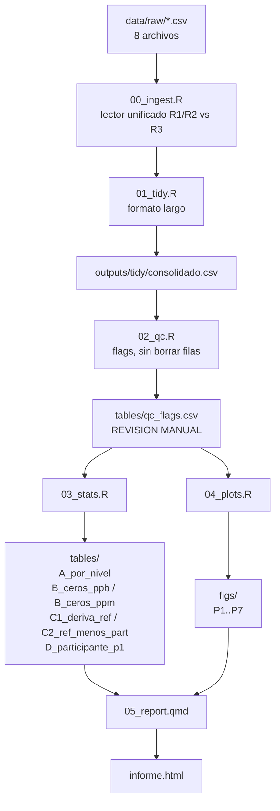

# Workflow de análisis — Rondas PT

Complemento operativo de [`plan_analisis.md`](plan_analisis.md). Aquí va el "cómo y en qué orden"; el "qué y por qué" está en el plan.

Formato: Markdown. Un JSON no aporta nada aquí — los pasos se ejecutan a mano o vía `source()`, no los consume ninguna máquina.

## Diseño del ejercicio

| | Fecha | Analitos | Participante | Referencia |
|---|---|---|---|---|
| R1 | 23–24 abr | SO2, CO | P1 | CalAire 4U |
| R2 | 30 abr – 2 may | O3, NO, NO2 | P1 | CalAire 4U |
| R3 | 15–16 jul | O3, NO, NO2 | P2 (`ZFT5R6`) | CalAire 4U |

R1↔R2: mismo participante, analitos distintos. R2↔R3: mismos analitos, participante distinto. La referencia CalAire es la única constante en las tres rondas — de ahí que sea el único eje con continuidad temporal.

### Matriz de comparación del bloque C

Cuatro series: `ref_R2`, `P1`, `ref_R3`, `P2`.

| # | Par | Clase | Apareado | Escala |
|---|---|---|---|---|
| C1 | `ref_R2` ↔ `ref_R3` | inter-ronda | no | error relativo |
| C2 | `ref_R2` ↔ `P1` | intra-ronda | **sí** | concentración |
| C3 | `ref_R3` ↔ `P2` | intra-ronda | **sí** | concentración |
| C4 | `ref_R2` ↔ `P2` | inter-ronda | no | error relativo |
| C5 | `ref_R3` ↔ `P1` | inter-ronda | no | error relativo |
| C6 | `P1` ↔ `P2` | inter-ronda | no | error relativo, descriptivo |

Regla dura: los pares inter-ronda no comparten minuto ni mezcla de gas, y en NO/NO2 tampoco nominal. Nada de Bland-Altman, correlación ni diferencia pareada sobre ellos — sólo agregados por nivel en error relativo.

Cierre de la matriz: si `C3 − C2 ≈ C1`, la brecha entre participantes se explica por la deriva del 4U; si no cierra, hay diferencia real P1 vs P2.

### Nominales verificados y comparabilidad

| Analito | R2 | R3 | Escala del bloque C | Niveles |
|---|---|---|---|---|
| O3 | 0/180/120/80/40 | 0/180/120/80/40 | concentración y error relativo | 1, 2, 3, 4, 5 |
| NO | 0/180/119/78/37 | 0/179/119/80/41 | concentración y error relativo | 1, 2, 3, 4, 5 |
| NO2 | 0/140/105/60/30 | 0/144/112/64/32 | sólo error relativo | **1**, 2, 4, 5 |

- **Nivel 1 (cero)**: se mantiene en los tres analitos, NO2 incluido. Nominal cero en ambas rondas, así que no admite error relativo — se compara en **unidades absolutas** (ppb). Es el único nivel con nominal idéntico entre R2 y R3 en los tres analitos.
- Las diferencias de nominal en **NO** se aceptan como tolerables (máx. +10.8% en el nivel 5). Comparable en concentración.
- **NO2 nivel 3** (105 vs 112, +7 ppb) queda **excluido del bloque C**. Única exclusión. Los niveles 1 (cero), 2 (140/144), 4 (60/64) y 5 (30/32) se mantienen.
- `R3_NO2` nivel 2: nominal declarado 144 frente a ~154 medido en ambos equipos. Documentado, **sin corrección de sesgo**. Entra en el análisis como cualquier otro nivel.

## Estructura

```
data_use_cases/
  data/raw/                 <- 8 CSV de entrada (no se modifican)
  scripts/
    00_ingest.R
    01_tidy.R
    02_qc.R
    03_stats.R
    04_plots.R
    05_report.qmd
  outputs/
    tidy/consolidado.csv
    tables/
    figs/
```

## Grafo



## Pasos

### Paso 0 — Verificación previa (completada)

Hecho. Resultados incorporados arriba y en el plan:

- Nominales de R3 verificados. O3 idéntico a R2; NO con diferencias toleradas; NO2 sólo en error relativo y sin el nivel 3.
- `R3_NO.csv` y `R3_NO2.csv` son multicanal (10 columnas: NO, NO2, NOx × 2 equipos). El ingest debe manejar dos anchos de tabla.
- `Samp<` en `R3_NO.csv` línea 73, columnas del participante.
- `R3_NO2` nivel 2: nominal 144 vs ~154 medido en ambos equipos. Documentado, sin corrección.
- `Samp<` se convierte a **NA puntual**: sólo la celda afectada, sin descartar la ventana alrededor.

**Sin pendientes.** Todas las decisiones de diseño están cerradas; se puede pasar directo al paso 1.

### Paso 1 — `00_ingest.R`

Función `read_round(path)`:

- detecta el formato del header: `date time` (R3) frente a `date`, `time` (R1/R2)
- detecta el **ancho de tabla**: monocanal (`R1*`, `R2*`, `R3_O3`) frente a multicanal (`R3_NO`, `R3_NO2`, con NO/NO2/NOx por equipo)
- lee las columnas de medida como **texto** y convierte de forma explícita. Los literales de estado del instrumento (`Samp<` u otros) pasan a **NA puntual** — sólo la celda, nunca la fila ni la ventana. Registra cuántos se convirtieron y en qué archivo y línea
- normaliza `24:00` a `00:00` del día siguiente **antes** de parsear el timestamp
- identifica el rol por sufijo de columna: `4U*` = referencia CalAire, el otro serial = participante
- deriva el **analito bajo prueba** del nombre del archivo, no del prefijo de columna (en `R3_NO2` el analito es `no2_*` aunque haya también `no_*` y `nox_*`); marca los demás canales como concomitantes
- parsea `runtime` como duración (`HH:MM` -> minutos), no como hora del día

Salida: lista de data frames crudos, uno por archivo, más un log de conversiones no numéricas.

### Paso 2 — `01_tidy.R`

Esquema único en formato largo:

```
ronda | analito | canal | es_analito | unidad | ts | runtime_min | level | nominal | err_rel | rol | serial | participante | valor
```

- `rol`: `ref` o `part`.
- `unidad`: `ppb` o `ppm`.
- `participante`: `P1` (R1 y R2) o `P2` (R3); `NA` cuando `rol == "ref"`.
- `canal`: `no`, `no2`, `nox`, `o3`, `so2`, `co`. En archivos monocanal coincide con el analito.
- `es_analito`: `TRUE` para el canal bajo prueba, `FALSE` para los concomitantes de R3. Toda la estadística de los bloques A–D filtra `es_analito == TRUE`; el bloque E usa los `FALSE`.
- `err_rel`: `(valor − nominal)/nominal`, `NA` en el nivel 1 (nominal cero). Columna precalculada porque el bloque C la usa en los pares inter-ronda de los niveles 2–5. En el nivel 1, el bloque C usa `valor` en absoluto.

Salida: `outputs/tidy/consolidado.csv`.

Salida: `outputs/tidy/consolidado.csv`.

### Paso 3 — `02_qc.R`

Añade columnas de flag. **No elimina filas.**

| Flag | Criterio |
|---|---|
| `flag_na` | valor ausente |
| `flag_gap` | `diff(ts) > 2 min` |
| `flag_transient` | `level == "estab"` |
| `flag_gen_mismatch` | `abs(valor - nominal) > 0.20 * nominal` dentro de un nivel estable |
| `flag_outlier` | Hampel: mediana móvil ventana ±7, umbral 3·MAD, dentro de cada nivel estable |
| `flag_no_numerico` | literal de estado del instrumento en origen (`Samp<` u otro), convertido a NA puntual |
| `flag_nox_residuo` | sólo R3 multicanal: `abs(NO + NO2 − NOx)` por encima del umbral |

Salidas: `consolidado_qc.csv` y `tables/qc_flags.csv` (conteo de flags por ronda-analito-nivel).

**Punto de control manual.** Revisar `qc_flags.csv` antes de continuar. Verificar en particular:

- el gap de `R2C_NO2` aparece como un único `flag_gap` de ~12 h
- el desfase del generador de `R2B_NO` aparece como `flag_gen_mismatch` en ~6 filas del nivel 1
- las excursiones de `R2A_O3` en el nivel 2 quedan marcadas como `flag_outlier`
- `R3_NO` línea 73 aparece con `flag_no_numerico` en las tres columnas del participante
- `R3_NO2` nivel 2 dispara `flag_gen_mismatch` en **ambos** roles (es la anomalía de nominal, no de medida). Si sólo lo dispara en uno, revisar la lectura. El flag es informativo: no excluye el nivel ni corrige el sesgo

Si algo de esto no aparece, los umbrales están mal calibrados.

### Paso 4 — `03_stats.R`

Filtro para toda la estadística: `level %in% 1:5 & !flag_transient`. Los `flag_outlier` se reportan en dos variantes (con y sin), no se descartan en silencio.

Salidas:

| Archivo | Contenido |
|---|---|
| `tables/A_por_nivel.csv` | n, media, sd, CV%, sesgo absoluto y relativo, dif ref−part, LoA Bland-Altman, pendiente de deriva intra-nivel con IC |
| `tables/B_ceros_ppb.csv` | comparación de ceros, analitos en ppb |
| `tables/B_ceros_ppm.csv` | comparación de ceros, CO en ppm |
| `tables/C_matriz.csv` | las 6 comparaciones en formato largo: `par`, `clase`, `analito`, `nivel`, `escala` (`absoluto` en el nivel 1, `err_rel` en 2–5), `estadistico`, `valor`, `ic_inf`, `ic_sup` |
| `tables/C_cierre.csv` | `C3 − C2` frente a `C1` por analito y nivel: ¿la brecha entre participantes se explica por la deriva del 4U? |
| `tables/D_participante_p1.csv` | P1 a través de R1 y R2: ruido de cero, sesgo relativo, deriva intra-nivel, por analito. Descriptivo |
| `tables/E_nox_r3.csv` | residuo `NO + NO2 − NOx` por equipo y nivel. Sólo R3 |
| `tables/descartes.csv` | puntos excluidos por nivel y motivo |

Los ceros van en dos tablas separadas por unidad — sin normalizar a fracción de span.

**Reglas duras del bloque C:**

1. Los pares intra-ronda (C2, C3) se calculan apareados punto a punto, en concentración.
2. Los pares inter-ronda (C1, C4, C5, C6) se calculan **sólo** sobre agregados por nivel, en error relativo. Prohibido Bland-Altman, correlación o diferencia pareada sobre ellos: no comparten minuto, mezcla de gas ni, en NO/NO2, nominal.
3. C6 se reporta sin contraste formal. Descriptivo.
4. El nivel 1 (cero) **entra en el bloque C** para los tres analitos, NO2 incluido, pero en **unidades absolutas**: nominal cero, sin error relativo posible. El bloque B lo trata en detalle; en C aporta el cruce de rondas más limpio, por ser el único nivel con nominal idéntico en R2 y R3.
5. **El nivel 3 de NO2 se excluye del bloque C** (nominal 105 en R2 vs 112 en R3). Única exclusión de la matriz. Sigue presente en los bloques A y B, que son intra-ronda.
6. No se aplica corrección de sesgo a ningún nivel, incluido el nivel 2 de `R3_NO2`. Los sesgos se reportan como se calculan.

### Paso 5 — `04_plots.R`

| ID | Salida | Notas |
|---|---|---|
| P1 | `figs/P1_serie_{ronda}_{analito}.png` | 8 archivos |
| P2 | `figs/P2_niveles_{ronda}_{analito}.png` | 8 archivos, `scales="free_y"` |
| P3 | `figs/P3_ceros_ppb.png`, `figs/P3_ceros_ppm.png` | 2 archivos |
| P4 | `figs/P4_bland_altman.png` | 1 archivo, facet |
| P5 | `figs/P5_matriz_C.png` | 1 archivo, 3 paneles (O3, NO, NO2). Las 4 series vs nivel, en error relativo (niveles 2–5). Figura central del bloque C. El nivel 3 de NO2 aparece vacío, con nota al pie |
| P5c | `figs/P5c_ceros_matriz.png` | 1 archivo, 3 paneles. Nivel 1 de las 4 series en **ppb absolutos**. Complementa P5, que no puede representar el cero |
| P5b | `figs/P5b_cierre.png` | 1 archivo. `C3 − C2` frente a `C1` por analito y nivel |
| P6 | `figs/P6_referencia_ppb.png`, `figs/P6_referencia_ppm.png` | 2 archivos |
| P7 | `figs/P7_participante_p1.png` | 1 archivo. P1 a través de R1 y R2, descriptivo |
| P8 | `figs/P8_nox_r3.png` | 1 archivo. Conservación de NOx, sólo R3 |

Convención transversal: `ref` y `part` con color fijo en todas las figuras; zonas `estab` en gris; línea horizontal punteada en el nominal. En P5, P5b y P7 etiquetar ronda y participante (`ref_R2`, `P1`, `ref_R3`, `P2`) en el propio panel — son cuatro series discretas, nunca una serie continua en el tiempo. En P5, anotar al pie la exclusión del nivel 3 de NO2 y la observación sobre el nominal del nivel 2.

### Paso 6 — `05_report.qmd`

Secciones:

1. Diseño del ejercicio y control de calidad (tabla de rondas/participantes, nominales, descartes, problemas conocidos)
2. Desempeño por nivel
3. Comparación de ceros (ppb y ppm por separado)
4. Matriz R2 × R3: las 6 comparaciones, y el cierre `C3 − C2` vs `C1`
5. Deriva del analizador de referencia (~2.5 meses) — resultado principal, se desprende de C1
6. Caracterización del participante P1 a través de R1 y R2
7. Conservación de NOx en R3
8. Limitaciones

## Orden de ejecución

```
Paso 0  verificacion R3_NO / R3_NO2             <- HECHO, sin pendientes
Paso 1  source("scripts/00_ingest.R")
Paso 2  source("scripts/01_tidy.R")
Paso 3  source("scripts/02_qc.R")               -> revisar qc_flags.csv
Paso 4  source("scripts/03_stats.R")
Paso 5  source("scripts/04_plots.R")
Paso 6  quarto render scripts/05_report.qmd
```

Los pasos 4 y 5 son independientes entre sí; ambos dependen del 3.

## Supuestos vigentes

- El analizador de referencia (`4UXXXX` / `4UDY72`) es el mismo equipo físico en las tres rondas. Sobre este supuesto descansa toda la interpretación de deriva del bloque C1. Si se invalida, C1 pasa a ser comparación entre equipos y hay que reescribir la sección 4 del informe.
- `R2C_NO2` entra en la comparación de ceros pese al truncamiento, siempre acompañado de su caveat.
- El participante de R1 y R2 es el mismo (P1); el de R3 es otro (P2). Confirmado. Ninguna diferencia observada en el participante entre R2 y R3 es atribuible a deriva.
- n = 1 ronda por participante. Toda comparación entre laboratorios (C6) es descriptiva, sin contraste formal.
- Los nominales cambian entre R2 y R3. Las diferencias de NO se aceptan como tolerables y se compara en concentración; NO2 va sólo en error relativo y sin el nivel 3 (105 vs 112).
- El nominal del nivel 2 de `R3_NO2` (144 declarado, ~154 medido en ambos equipos) queda documentado sin corrección. Los sesgos no se ajustan en ningún nivel.
- `Samp<` y cualquier otro literal de estado del instrumento se convierten a NA puntual, sin descartar la ventana.
